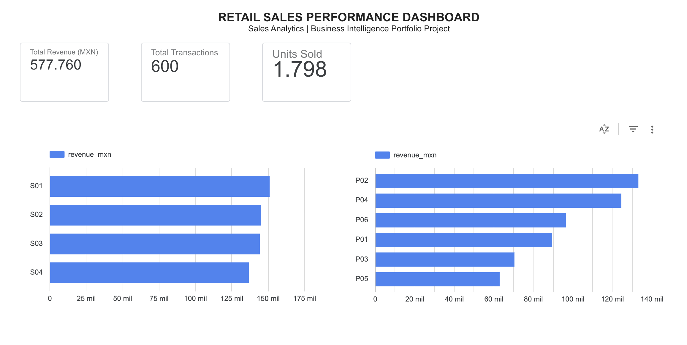

# Retail Sales Intelligence | BI Dashboard

## Project Overview

An interactive Business Intelligence dashboard developed using **Google Looker Studio** to visualize and analyze retail sales performance.

This portfolio project demonstrates data visualization, KPI reporting, sales analysis, and business intelligence fundamentals using a sample retail sales dataset.

## Live Dashboard

**[View Interactive Dashboard](https://datastudio.google.com/reporting/6462c262-345e-4945-a5bf-20786355bcc1)**

## Key Performance Indicators

| Metric | Value |
|---|---|
| Total Revenue | MXN $577,760 |
| Total Transactions | 600 |
| Units Sold | 1,798 |

## Dashboard Features

- **Revenue by Store:** Compare sales performance across four retail locations.
- **Revenue by Product:** Identify top-performing products and compare revenue contributions.
- **Sales KPIs:** Monitor total revenue, transaction volume, and units sold.
- **Interactive Visualizations:** Explore retail performance using Looker Studio charts.

## Tools & Technologies

- **Google Looker Studio:** Business intelligence reporting and interactive dashboard development.
- **CSV:** Source data ingestion and reporting.
- **GitHub:** Project documentation and portfolio hosting.

## Key Insights

- Total recorded revenue reached MXN $577,760 across 600 transactions.
- The dataset contains 1,798 units sold.
- Store S01 generated the highest revenue among the four stores.
- Product P02 was the highest-revenue product in the dataset.

## Project Scope

This is a personal learning and portfolio project using sample retail sales data. It demonstrates foundational BI reporting and visualization techniques rather than production analytics or real business performance.

## Author

**Kristal Pastor**

Bilingual Content Specialist | Technical Content & Data Analytics
